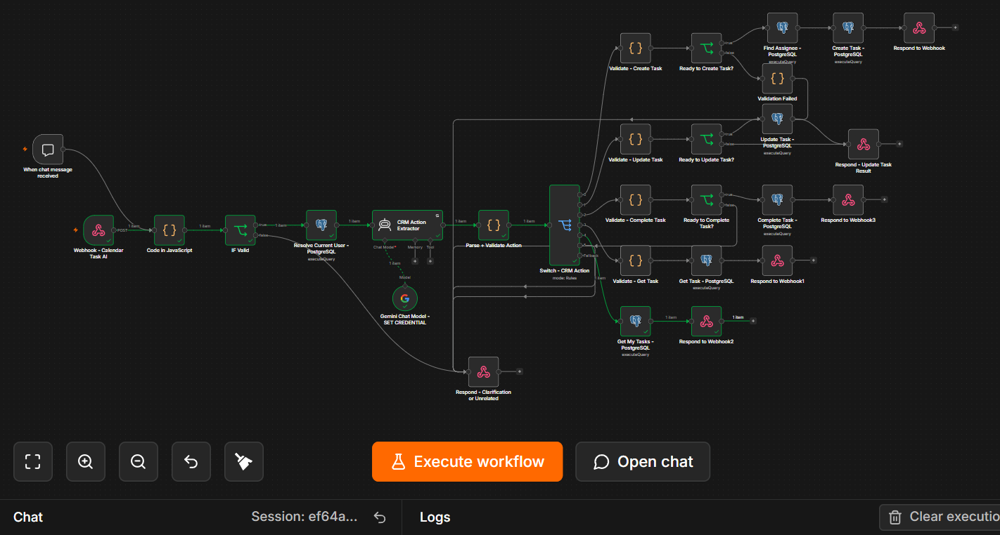

# Hi, I'm Abhinay Vallamkonda

**2026 Computer Science Graduate | AI Engineer Intern | Python, Backend & AI Workflows**

I build and explore practical software using Python, APIs, databases, local language models, and workflow automation. My internship work includes RAG, FastAPI services, n8n workflows, and conversational interfaces for business applications.

I'm seeking entry-level software engineering, Python backend, and AI engineering opportunities, with Hyderabad as my preferred location.

## Technical toolkit

| Area | Technologies I've worked with |
| --- | --- |
| Languages | Python, Java, SQL, JavaScript |
| Backend & integration | FastAPI, REST APIs, JSON, n8n, MCP |
| AI & language models | Ollama, Hugging Face Transformers, LangChain, LangGraph, RAG |
| Data & storage | PostgreSQL, DuckDB, Pandas, MongoDB |
| Development | Git, GitHub, VS Code, Windows, WSL/Linux |
| Analytics | Exploratory data analysis, Apache Superset |

## Selected work

The following summaries describe my work and experiments. The linked case study is a project overview; runnable demos and measured results will be added as individual projects are prepared for publication.

### [Abhinay's AI Task Assistant](projects/calendar-task-ai/README.md)

- A portfolio case study covering natural-language task management with n8n, JavaScript, a language model and PostgreSQL.
- Describes features, general design, engineering lessons and next steps.
- Documentation only; no internal source code or operational data is published.

### Local LLM JSON-to-Summary Service

- Developed and experimented with a FastAPI service for turning structured business KPI data into natural-language summaries.
- Worked with local language models through Ollama and explored CPU-only inference.
- Integrated DuckDB and checked summaries against numeric source data.
- Focus: numeric accuracy, response latency, and clear API contracts.

### Conversational PostgreSQL CRUD Workflows

- Built n8n workflows for creating, reading, updating, and deleting customer records in PostgreSQL.
- Explored a chat interface for routing requests to the appropriate database operation.
- Focus: structured inputs, validation, and predictable responses.

### Employee Information & Timesheet Automation

- Worked on employee record creation and updates with mandatory-field, email, phone, and date validation.
- Explored using the authenticated employee context instead of asking users to enter their identity repeatedly.
- Worked on optional time inputs and hours calculation for timesheet requests.
- Focus: identity-aware workflows, partial updates, and handling missing input.

### CRM Assistant Workflows

- Worked on conversational workflows for calendar tasks, events, and business contacts.
- Explored tool-based actions and API integrations for business applications.
- Focus: interpreting user requests and mapping them to structured actions.

### Data Analytics & Dashboards

- Worked on exploratory data analysis with government datasets and on Apache Superset dashboards.
- Focus: cleaning data, calculating metrics, and presenting understandable findings.

### Local Image-to-Video Experiment

- Explored an n8n workflow connecting image input, LLM-generated prompts, and local generation.
- Status: experimental; subject-motion generation requires further work and validation.

Company-related entries are high-level experience summaries. Public demos should use independently shareable code and synthetic data.

## Engineering goals

- Strengthen Python, data structures, SQL, and backend fundamentals.
- Build reproducible projects with setup instructions, sample requests, and clear error handling.
- Add meaningful tests for validation, authorization boundaries, and failure cases.
- Evaluate AI features with concrete examples and measured results.
- Explain design decisions and limitations clearly in project documentation.

## Education

**B.Tech in Computer Science and Engineering** — Malla Reddy University, 2026  
**CGPA:** 8.06/10

## Connect

- [LinkedIn](https://www.linkedin.com/in/abhinay-vallamkonda-0b50b0325)
- [GitHub](https://github.com/vallamkondaabhinay)

